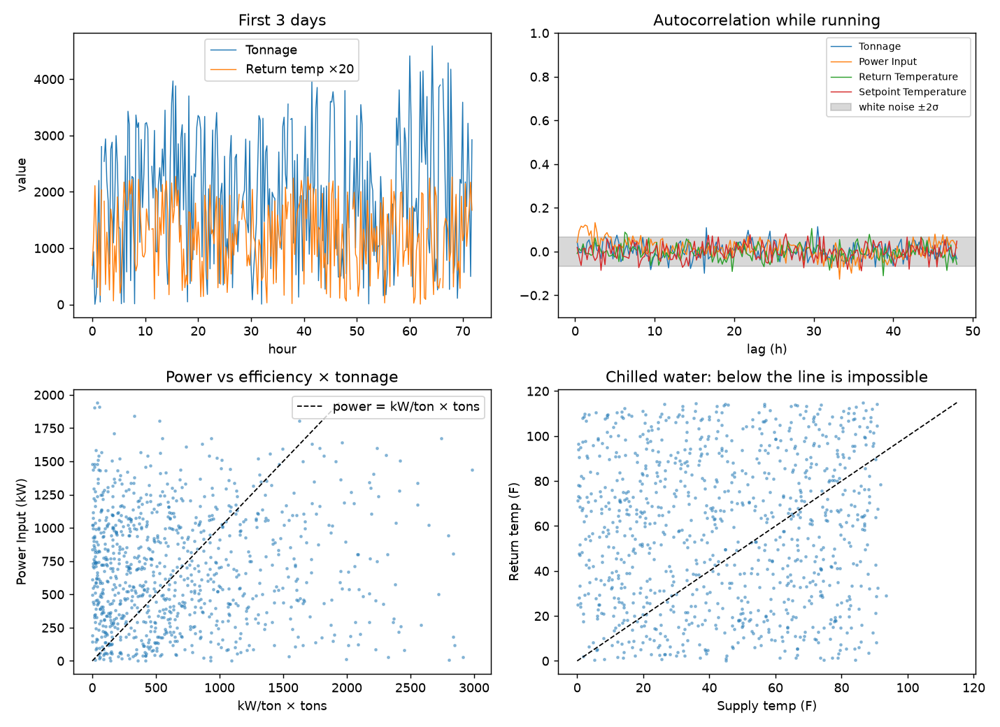

# Chiller 6 telemetry is synthetic noise

**Verdict.** Apart from an on/off pattern, AssetOpsBench's
Chiller 6 telemetry
(`src/couchdb/scenarios_data/shared/iot/chiller_6.json`)
is independent random draws. While the chiller runs, each
sensor is white noise, and sensors that physics ties
together are uncorrelated. Each sensor's median is
plausible on its own, but the joint behaviour is not a
chiller. AssetOpsGym therefore keeps the sensor names and
generates its own physically coupled telemetry (T5).

Reproduce: `analysis/chiller6.py` (prints the numbers
below and writes `chiller6.png`).

## Data

- 2,896 rows: 2,811 complete rows on a 15-minute grid,
  covering June 1–30, 2020, plus about 20 irregular event
  rows appended at the end of the file (`Run Status` and
  partial readings). `Schedule` appears in only 2 rows.
- The chiller runs (tonnage > 0) in 948 rows, 34%. When
  it is off, the load sensors are 0 but the temperatures
  keep printing values.

## Checks (running rows only)

| Check | Real chiller | Chiller 6 |
|---|---|---|
| Lag-1 autocorrelation, 15 min | ≈ 0.9 (thermal inertia) | −0.03 to 0.05 on all 10 sensors, inside the white-noise band ±0.066 |
| Daily load cycle | strong | none (ANOVA across hours p = 0.10) |
| Power = kW/ton × tons | identity | corr 0.045 |
| Tonnage vs % loaded | ≈ 1 | corr 0.044 |
| Return > supply temp | always while cooling | violated in 38% of rows |
| Setpoint | constant or step changes | std 26.5 °F, roughly uniform over 0–91 °F |
| Ranges | % loaded ≤ ~105, supply ≈ 42–46 °F | % loaded 0–193, supply 0–93 °F |

The autocorrelation over the whole file (≈ 0.66 for the
load sensors) comes entirely from the on/off blocks: it
is ≈ 0 once the off rows are excluded. The run start
times are spread over all hours of the day, so there is
no operating schedule either.

## What we use instead

`server/sim.py` keeps Chiller 6's sensor names and
15-minute grid, with values coupled by construction:

- **Load:** an occupancy schedule (weekday 6–22 h,
  weekend 8–18 h) plus AR(1) weather.
- **Physics:** power = tons × kW/ton;
  return = supply + 10 × load; setpoint fixed at 44 °F,
  which matches the file's median of 44.2.
- **Faults:** each fault shifts the specific sensors its
  physics touches.

The 800-ton capacity is our choice: the file's median of
2,130 tons can't be checked against anything.

**Question for Dhaval:** is there a real (even
anonymized) chiller trace we could use to calibrate the
noise levels and the daily load shape?
